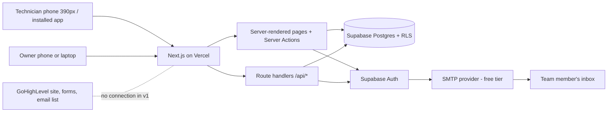
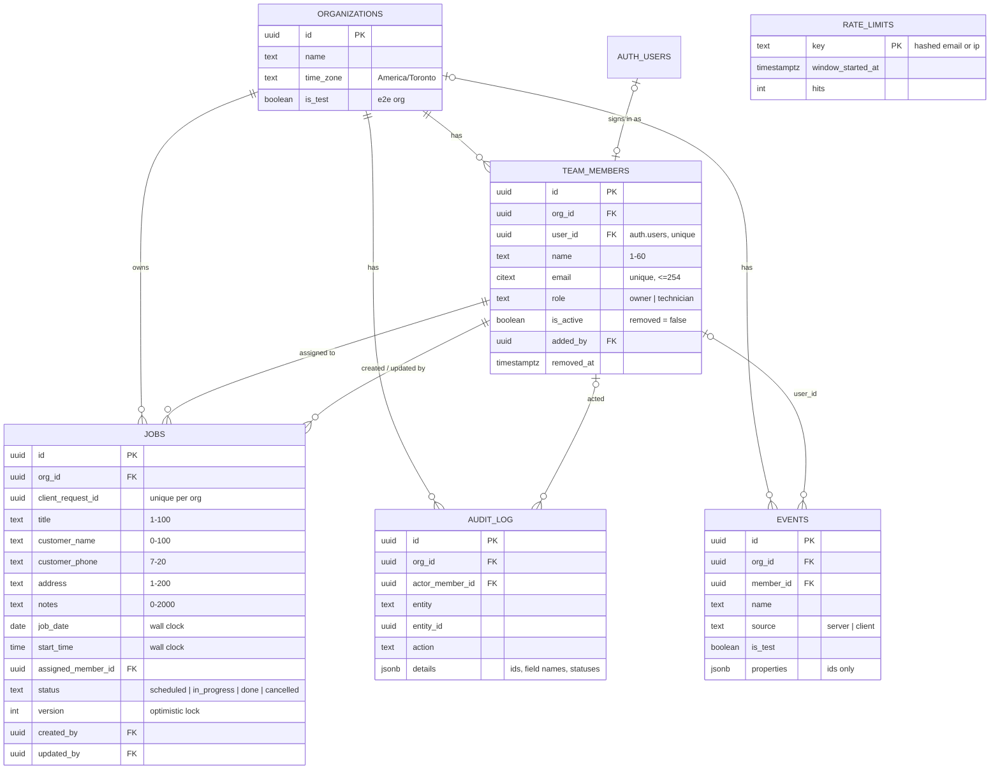

# Architecture: Tech Job Board (Northside Plumbing)

**Status:** proposed (locked at Gate 2) · **Build mode:** hybrid (no platform sync in v1, decision 0007) · **Decisions:** `docs/decisions/` · **Security model:** `docs/SECURITY_MODEL.md` · **Contract:** `docs/openapi.yaml` · **Integration contract:** `docs/integration-contract.md`

## Summary
One Next.js (App Router, TypeScript strict) app on Vercel, on its `*.vercel.app` address, with Supabase Postgres and Supabase Auth: the house stack with no deviations (decision 0001). The app is the system of record for the team list, jobs, assignments and statuses. GoHighLevel keeps the website, forms and email list and is not called in v1 (decision 0007). People sign in with one email that carries both a link and a 6-digit code. Only pre-provisioned, active team members can sign in (decision 0002), and mail goes out through a free-tier SMTP provider (decision 0003, spend gate). Every table has RLS keyed on `org_id`. Who may change which column, optimistic concurrency, audit and analytics events are enforced in the database (decision 0005). The e2e suite runs in a separate test org on every environment, so it never touches the real board (decision 0004). The app is installable (web manifest plus a minimal service worker that caches only the offline screen).

## System diagram


## Modules
| Module | Responsibility | Lives in | Lane |
|---|---|---|---|
| Session and guards | Read the Supabase session from cookies, resolve the active team member, enforce the permission matrix, map DB errors to problem+json | `src/lib/server/auth.ts`, `src/lib/server/http.ts`, `middleware.ts` | backend |
| Sign-in service | `requestSignIn`, `verifyCode`, `confirmLink`, `signOut`; rate limits; sign-in events | `src/lib/server/services/auth.ts`, `src/app/auth/confirm/route.ts` | backend |
| Admin client | Service-role Supabase client: create, ban and unban auth users; sign-in lookups; sign-in events | `src/lib/server/admin.ts` | backend |
| Board and jobs | Day board query, job read, create, update, status, cancel; version and idempotency handling | `src/lib/server/services/jobs.ts`, `src/app/api/board/`, `src/app/api/jobs/` | backend |
| Team | List, add or reactivate (with auth user provisioning), remove (with ban) | `src/lib/server/services/team.ts`, `src/app/api/team/`, `src/app/api/technicians/` | backend |
| Events | Validate and record client events through `public.record_client_event` | `src/app/api/events/` | backend |
| Health | `GET /api/health` (optional `check=db`) | `src/app/api/health/` | backend |
| Sign-in screens | SCR-01 (email → "sent" → code entry), SCR-02, Server Action wrappers calling the sign-in service | `src/app/(auth)/**` | frontend |
| Board UI | SCR-03 day board, day bar, cards, status control, refresh, install card, event sending | `src/app/(app)/board/`, `src/components/board/` | frontend |
| Job UI | SCR-04 job detail, SCR-05 job form (create and edit), stale and failed states | `src/app/(app)/jobs/`, `src/components/jobs/` | frontend |
| Team UI | SCR-06 team list, add and remove | `src/app/(app)/team/`, `src/components/team/` | frontend |
| App shell and PWA | Header, SCR-07 offline page, SCR-08 not-allowed page, `manifest.ts`, icons, `public/sw.js` | `src/app/(app)/layout.tsx`, `src/app/manifest.ts`, `src/app/offline/`, `public/sw.js`, `public/icons/**` | frontend |
| Schema and rules | Tables, RLS, guard and audit triggers, rate limiter, retention | `supabase/migrations/**`, `supabase/tests/rls/**` | architect |

## Data model
Derived from the screen inventory in `docs/user-flows.md`. SCR-03 needs every job of a day with the technician's name and removed flag. SCR-04 and SCR-05 need one job, its version and the active technicians. SCR-06 needs the team list with role and active flag. SCR-01 needs an "is this email active?" lookup, which only the server ever sees.



Key queries and their indexes:
| # | Query (screen) | Index |
|---|---|---|
| Q1 | Day board: jobs of org X on date D by `start_time`, `created_at`, joined to the technician's name and `is_active` (SCR-03, FR-6) | `jobs_board_idx (org_id, job_date, start_time, created_at)`, join by PK on `team_members` |
| Q2 | One job by id in the caller's org (SCR-04, SCR-05 edit) | `jobs_pkey` |
| Q3 | Versioned write: `update jobs … where id = $1 and version = $2` (FR-14) | `jobs_pkey` |
| Q4 | Idempotent create replay: job by `(org_id, client_request_id)` (AC-003.6) | `jobs_client_request_unique` |
| Q5 | Active technicians of org X by name (SCR-05) | `team_members_org_role_active_idx (org_id, role, is_active, name)` |
| Q6 | Team list of org X (SCR-06) | `team_members_org_role_active_idx` |
| Q7 | Sign-in: active member by email, case-insensitive (SCR-01, FR-1) | `team_members_email_key` (citext unique) |
| Q8 | Every RLS check: active member by `auth.uid()` | `team_members_user_id_key` (unique on `user_id`) |
| Q9 | Metrics: events by name over a window | `events_name_occurred_idx (name, occurred_at)` |
| Q10 | Retention: events older than 13 months; rate-limit windows older than a day | `events_occurred_idx`, `rate_limits_window_idx` |

## Direct Supabase access (no API route)
| Table | Operations | Why RLS alone is enough |
|---|---|---|
| none in v1 | none | The browser talks only to our pages and `/api/*`. The Data API is still reachable with a user's token, which is why every rule is also in RLS and the guard triggers (decision 0005). If US-013 is approved: Realtime `postgres_changes` on `jobs` (select only, RLS applies), used only as a "refetch the board" signal. |

## Stories served without the API
| Story | Why |
|---|---|
| US-001 | Partly. Requesting a link or code, verifying the code and confirming the link happen before a session exists, so they are Server Actions and one route handler (below), not `/api/*` operations. `GET /api/me` (x-stories US-001) serves the signed-in side. |
| US-005 | Installability is static: `src/app/manifest.ts` (name, 192 and 512 px icons, `display: standalone`, `start_url: /board`), an Apple touch icon, and `public/sw.js`, which caches only `/offline` and the shell assets so SCR-07 shows with no connection. No data operation. |
| US-012 | P2. Tap to call and tap for maps are links built in the frontend from `customer_phone` (`tel:`) and `address` (maps search URL, URL-encoded so `#` and `&` survive, AC-012.4). Nearly free. |
| US-013 | P2, not approved. If approved: one additive migration adding `public.jobs` to the `supabase_realtime` publication, and a client subscription that refetches `GET /api/board` on any change. "Live updates paused" shows when the channel errors. Nearly free. |

## Sign-in (outside the JSON API)
Specified here because the frontend (screens and Server Action wrappers) and the backend (service) build it in parallel. Decision 0002 has the reasons.

**Service interface** (`src/lib/server/services/auth.ts`, backend):
```ts
type RequestOutcome = 'sent' | 'wait' | 'failed';   // 'sent' for listed and unlisted alike
requestSignIn(input: { email: string; ip: string }): Promise<RequestOutcome>;
verifyCode(input: { email: string; code: string }): Promise<'ok' | 'invalid_or_expired'>;  // sets session cookies on 'ok'
confirmLink(input: { token_hash: string }): Promise<'ok' | 'invalid_or_expired'>;          // sets session cookies on 'ok'
signOut(): Promise<void>;
```

**`requestSignIn` steps:**
1. Normalise: trim and lowercase. If it isn't a syntactically valid email of 254 characters or fewer, return `sent` (no lookup, no send).
2. `hit_rate_limit('ip:' + sha256(ip), 900, 10)` and `hit_rate_limit('email:' + sha256(email), 60, 1)`. If either refuses, return `wait`. This happens for every address, listed or not (AC-001.5).
3. Look up an active member by email (admin client). If none, record `signin_link_requested` with no member and return `sent`. Nothing is sent (AC-001.3).
4. If found: `signInWithOtp({ email, options: { shouldCreateUser: false, emailRedirectTo: SITE_URL + '/auth/confirm' } })`. Supabase rate-limit error → `wait`. Any other error → log `signin_send_failed` (no email in the log) and return `failed` (AC-001.8). Success → record `signin_link_requested` (`listed = true`) and return `sent`.
5. Every outcome is returned no sooner than 1.5 s after the request arrived, so the listed and unlisted paths take about the same time.

**`verifyCode` / `confirmLink`:** `verifyOtp({ email, token, type: 'email' })` or `verifyOtp({ token_hash, type: 'email' })`. On success, check the user maps to an active member (else sign out and return `invalid_or_expired`), then record `signin_completed`. Failure → SCR-02 copy "This link has expired or was already used" (AC-001.6).

**Screens and routes (frontend, except the route handler):**
- `/sign-in` (SCR-01): email form → Server Action → `sent` shows "If this email is on the team, a link is on its way". Below it is a 6-digit code field: "Or type the code from the email", with numeric keyboard and `autocomplete="one-time-code"`. `wait` and `failed` show their messages. **The code field is a design addition** (design-specs, contract question 1).
- `/auth/confirm?token_hash=…&type=email` (route handler, backend): GET renders a page with one **Sign in** button. POST calls `confirmLink` and redirects to `/board`, or to `/link-expired` (SCR-02). Email scanners that prefetch the link don't use up the token.
- Sign out: a Server Action calling `signOut`, then redirect to `/sign-in` (AC-001.9).
- Email template (Supabase → Auth → Templates → Magic Link, set by devops): subject "Your Tech Job Board sign-in". The body has the link `{{ .SiteURL }}/auth/confirm?token_hash={{ .TokenHash }}&type=email` and the code `{{ .Token }}`, with "expires in 60 minutes; if you're using the app on your home screen, type the code there".

**Supabase Auth settings (devops):** sign-ups disabled · email OTP expiry 3600 s · OTP length 6 · custom SMTP (decision 0003) · time-box sessions 720 h (Pro), or the middleware fallback · Site URL and redirect allow-list = the environment's `*.vercel.app` URL.

**Middleware** (`middleware.ts`, backend): refreshes the session cookie (`@supabase/ssr`). Signed-out requests to app pages redirect to `/sign-in` before any data loads (AC-001.7). It is not the security boundary: every page and API handler calls `requireMember()`, which returns 401 or redirects to sign-in when the session has no active member (AC-011.1).

## Write rules and error mapping
All job and team writes go through `/api/*` with the **user's** session (anon key + user JWT), so RLS and the guard triggers apply. The service-role client is used only for the operations listed in `docs/SECURITY_MODEL.md`.

| Database outcome | API response |
|---|---|
| `BLA01 technician_not_assignable` | 422, `errors[{ field: assigned_member_id, code: technician_not_assignable }]` ("That technician is no longer on the team") |
| `BLA02` / `BLA03` / RLS `42501` on insert | 403 `not_allowed` |
| `BLA04 immutable_field` | 422 `validation_failed` (can only come from a malformed request) |
| `23505` on `team_members_email_key` | 409 `duplicate_email` |
| `23505` on `jobs_client_request_unique` | 200 with the existing job (idempotent replay) |
| `23514` / `22P02` / `22007` / `22008` check or format violation | 422 `validation_failed` with the field |
| Versioned update matched 0 rows | Re-read the job. Not visible → 404. Visible with another version → 409 `stale_version` with `current`. Visible with the same version → 403 |
| Status already equal / job already cancelled | 200 with the job, no write (no-op) |

Job writes, step by step: validate with the generated zod schema; normalise (trim, empty to null); for status and cancel no-ops, return early; `update … where id and version returning *`; map as above; return the `Job` shape with `is_mine` and `permissions` computed from the matrix.

Team add, step by step (owner): validate → find the member by email in the org (user client). If active → 409. If removed → update `is_active = true` and the name, unban the auth user (admin), return 200. If the email belongs to another org (admin lookup) → 409 with the same message. Otherwise create the auth user (admin `createUser`, `email_confirm: true`), insert the member with that `user_id` (user client), and return 201. If the insert fails, delete the auth user that was just created.

## Lane ownership (copied into build steps)
- **Backend:** `src/app/api/**`, `src/app/auth/**` (confirm route), `middleware.ts`, `src/lib/server/**` (services, auth, http, log, env, admin), `scripts/bootstrap-orgs.mjs`, `supabase/seed.sql`, `tests/api/**`, `tests/helpers/**`
- **Integration:** not dispatched in v1 (no platform calls, decision 0007)
- **Frontend:** `src/app/(app)/**`, `src/app/(auth)/**`, `src/app/offline/**`, `src/app/manifest.ts`, `public/sw.js`, `public/icons/**`, `src/components/**`, `src/hooks/**`, `src/lib/api/fetcher.ts`, `src/mocks/**`
- **Architect (contract — changes via contract question):** `docs/openapi.yaml`, `docs/integration-contract.md`, `supabase/migrations/**`, `supabase/tests/**`, `orval.config.ts`, `src/lib/shared/**`, generated `src/lib/api/generated/**` + `src/types/database.ts`
- **Designer (generated):** `src/app/theme.css`
- **QA:** `tests/e2e/**` (including the e2e sign-in helper of decision 0004), `tests/fuzz/**`, `playwright.config.ts`, `docs/test-plan.md`, `docs/qa-reports/**`
- **Security:** `.opengrep/**`, `.gitleaks.toml`, `scripts/security-scan.sh`
- **DevOps:** `.github/**`, `vercel.json`, `infra/**`, `scripts/install-scanners.sh`, `scripts/env-check.mjs`, `scripts/smoke.mjs`, `.env.example`, `docs/runbook.md`, `docs/deployments/**`; Supabase Auth settings, SMTP and email template; pg_cron enablement

## Environment variables (names only — values are set by Matthew)
| Name | Used by | Server-only? |
|---|---|---|
| `NEXT_PUBLIC_SUPABASE_URL` | client + server | no |
| `NEXT_PUBLIC_SUPABASE_ANON_KEY` | client + server (user-scoped client; RLS applies) | no |
| `SUPABASE_SERVICE_ROLE_KEY` | `src/lib/server/admin.ts` only; CI e2e setup (decision 0004) | **yes** |
| `SITE_URL` | `src/lib/server/services/auth.ts` (email redirect), `src/app/auth/confirm/route.ts` | yes |
| `SESSION_MAX_AGE_DAYS` | `middleware.ts` fallback 30-day cap (default 30) if the Supabase plan lacks time-boxed sessions | yes |
| `E2E_OWNER_EMAIL`, `E2E_TECH_A_EMAIL`, `E2E_TECH_B_EMAIL` | `tests/e2e/**` setup (CI only) | yes |
| `VERCEL_GIT_COMMIT_SHA` | `GET /api/health` `version` (set by Vercel) | yes |

SMTP credentials live in Supabase Auth settings, not in the app's environment.

## Capacity & reliability
| Concern | Expected (from PRD) | Plan |
|---|---|---|
| Jobs | Up to 30 a day (tested ceiling 50); under 10,000 in total; about 7,500 a year | Q1 index range of about 30–50 rows; the whole day in one response, capped at 500 |
| Team | 1 owner + 3 technicians (+3 e2e members per environment) | Trivial; cursor pagination kept by convention |
| Events | About 4 people × a few board views an hour, plus writes: under 300 a day, about 100k rows over 13 months | Two indexes; daily retention job |
| Audit | One or two rows per change: under 50 a day | Append-only; index on `entity_id` |
| Requests | Under 2,000 a day; peak concurrency about 4 people | Supabase and Vercel plans already in use are far above this; no cache or queue needed |
| Board within 2 s at p75 on 4G with 30 jobs (FR-7) | One server-rendered page: one session check + one indexed query (about 10 ms) and about 15 KB of JSON | Server Component renders the list; no client waterfall; `no-store` so data is always current |
| Slow work | None. Every request finishes in well under 1 s | All inline. Retention is a pg_cron job (daily) |
| Email provider down | Rare | "We couldn't send the link. Try again in a few minutes" (AC-001.8); failure logged; existing 30-day sessions unaffected; no retry queue (the person retries) |
| Supabase down | Rare | Board shows "Can't load the board" + Retry (AC-004.11); writes show "Not saved. Try again" with typed values kept; health `check=db` reports `degraded` |
| Double taps and retries | Common on phones | `client_request_id` on create; status and cancel no-ops; `version` on every write (decision 0005) |
| GHL / Calendar / QuickBooks | Not called in v1 | Nothing can fail (decision 0007) |

**Failure recovery per Must flow:**
- *Sign in (US-001):* the send fails → nothing stored except a rate-limit row and an event; the person retries after 60 s. Verify fails → no session; SCR-02 offers a new code.
- *Add technician (US-002):* auth user created but member insert fails → the server deletes the new auth user; retry is safe (re-running finds or creates the same auth user by email).
- *Create job (US-003):* network drops after the server saved → the retry with the same `client_request_id` returns the saved job (AC-003.11). The insert, audit row and event are one transaction, so they all happen or none does.
- *Board (US-004):* read-only; Retry reloads.
- *Install (US-005):* the service worker caches only the offline page; a stale cache can't show stale jobs.
- *E2E (US-006):* runs in the test org; repeat runs create new uniquely titled jobs there (AC-006.5) and never touch Northside's board (AC-006.6).

## Observability
- **Health:** `GET /api/health` → 200 `{ status, checks, version }`; `?check=db` adds a database round trip (503 if it fails). Used by devops uptime checks, smoke tests and AC-006.3. Path recorded for `docs/runbook.md`.
- **Logs:** structured JSON from `src/lib/server/log.ts`: `level`, `request_id`, `route`, `org_id`, `member_id`, `outcome`, `duration_ms`, error `code`. Never emails, names, phones, addresses, titles, notes, codes, tokens or cookies.
- **Errors:** Vercel function logs (default, $0). Sentry or similar only through a spend gate. Not proposed.
- **Analytics events:** exactly as `docs/metrics-spec.md` defines, stored in `public.events`. Server-side events are written by database triggers (job and team changes) and by the sign-in service through `public.record_auth_event` (service role). `board_viewed` and `board_load_failed` go through `POST /api/events` → `public.record_client_event`, which stamps the caller. The metrics spec's `user_id` is `team_members.id`. `is_test` marks the e2e org. Clients can't read the table; Baseleap staff query it with database access.
- **Audit trail:** `public.audit_log`, append-only (update and delete raise), written in the same transaction as each change (FR-18).
- **Retention:** `app.run_retention()` daily via pg_cron: events after 13 months, rate-limit rows after 1 day. Jobs and audit are kept (NG-6, OQ-11 open).
